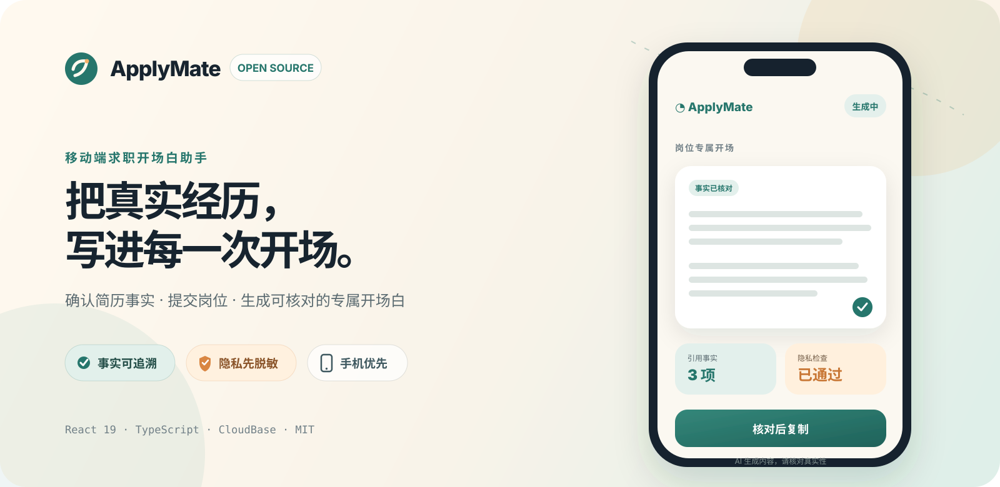
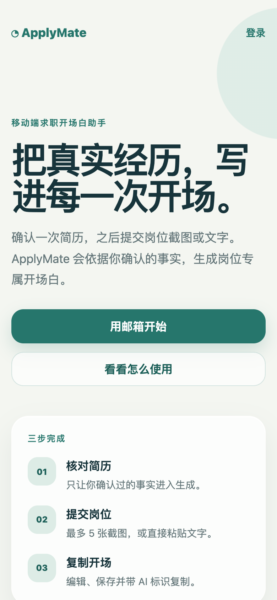
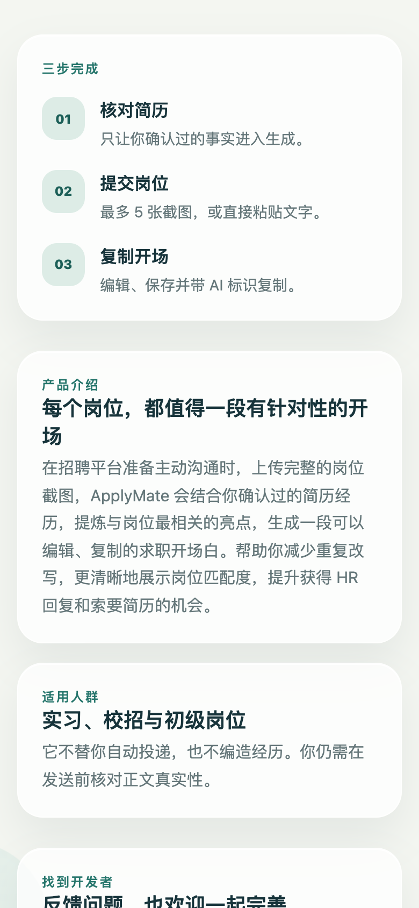
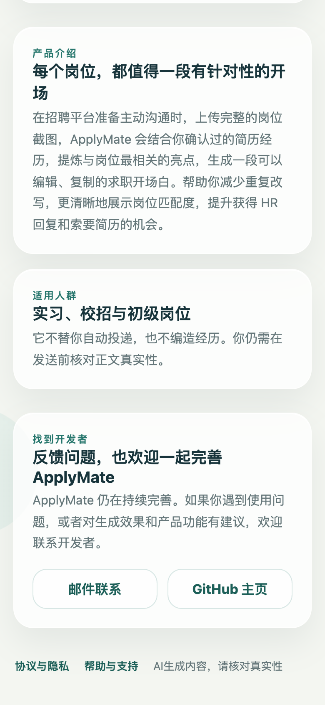
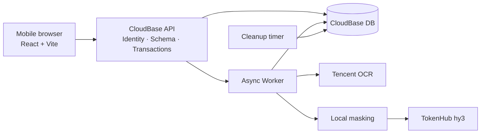

<div align="center">
  

  <h1>ApplyMate</h1>
  <p><strong>Turn verified experience into a job-specific opener.</strong></p>
  <p>A mobile-first assistant for internships, graduate roles, and early-career applications.</p>

  <p>
    <a href="README.md">简体中文</a> ·
    <a href="README.en.md">English</a>
  </p>

  <p>
    <a href="https://github.com/Yinzhi392/ApplyMate/actions/workflows/ci.yml"></a>
    <a href="LICENSE"></a>
    
    
  </p>
</div>

---

## What is ApplyMate?

Writing the first message to a recruiter is short work that often requires a surprising amount of repetition: read the job description again, find relevant resume evidence, adjust the tone, and check that nothing was overstated.

ApplyMate brings that flow into a mobile web app. A user confirms resume facts once, submits job text or screenshots, and receives an editable opener grounded in those confirmed facts.

It does not auto-apply and it does not invent experience. **The model helps with expression; the user remains the source of truth.**

## Product tour

<table>
  <tr>
    <td align="center"><strong>01 · Meet the product</strong></td>
    <td align="center"><strong>02 · Three-step flow</strong></td>
    <td align="center"><strong>03 · Low-anxiety UI</strong></td>
  </tr>
  <tr>
    <td></td>
    <td></td>
    <td></td>
  </tr>
</table>

The screenshots come from the current local Web code and contain no real resume, job, or account data.

## What the code enforces

| Capability | Concrete boundary |
|---|---|
| Traceable facts | Generated claims reference stable `factId` values; unknown facts and unsupported numbers are rejected |
| Privacy minimization | Original images go only to OCR; text is masked locally before it reaches the language model |
| Recoverable jobs | The API returns a `jobId` quickly; the client resumes polling after backgrounding or reconnection |
| Bounded cost | Budget reservation, successful-use quotas, concurrency and rate limits are handled server-side |
| Tenant isolation | Browsers cannot read business collections directly; queries use trusted server identity |
| Explicit lifecycle | The service supports active, read-only and retired phases plus account deletion boundaries |
| Mobile first | 320/390/430px layouts, touch targets, soft keyboards and route recovery are covered by tests |

ApplyMate deliberately does not auto-apply, fabricate experience, log raw user content, silently switch models, or describe local tests as a production launch.

## Architecture



See [`memory-bank/architecture.md`](memory-bank/architecture.md) for the complete current boundary.

## Local development

Requirements: Node.js `>=20 <25` and npm `>=10`.

```bash
git clone https://github.com/Yinzhi392/ApplyMate.git
cd ApplyMate
npm ci --ignore-scripts
cp web/.env.example web/.env.local
npm run web:dev
```

This is enough to view the public routes. Email sign-in, uploads, and AI jobs require your own CloudBase environment. Browser-safe values belong in `web/.env.local`; OCR, model, and service credentials must stay in server-side function environment variables.

Start with [`docs/web-cloudbase-setup.md`](docs/web-cloudbase-setup.md) for the full CloudBase checklist. This repository is not a one-click hosted SaaS template and does not include service credentials or hosted quota.

## Repository map

```text
web/                    React / Vite mobile Web
shared/                 Schemas, errors and cross-platform domain rules
cloudfunctions/api/     Identity, routing, transactions and reads
cloudfunctions/worker/  OCR, masking, generation, gates and persistence
cloudfunctions/cleanup/ Lifecycle cleanup and reservation release
tests/                  Unit, contract, integration, model and browser tests
memory-bank/            Current product, architecture, plan and evidence
miniprogram/            Archived legacy WeChat mini-program source
```

## Quality gates

```bash
npm run typecheck
npm run web:typecheck
npm test
npm run web:build
npm run test:e2e
npm run check
```

Fixtures must be synthetic or anonymized. Do not put real resumes, raw job screenshots, production exports, secrets, or temporary access URLs in issues, pull requests, or Git history.

## Contributing and status

Read [`CONTRIBUTING.md`](CONTRIBUTING.md) before opening a pull request. Report vulnerabilities privately through [`SECURITY.md`](SECURITY.md), and see [`ROADMAP.md`](ROADMAP.md) for possible next steps.

The Web v3 implementation and several local/pre-release gates are complete. A dedicated production environment, formal domain and regulatory setup, full device coverage, 30 real quality/privacy/latency runs, and professional compliance review are not all complete. [`memory-bank/progress.md`](memory-bank/progress.md) is the source of verified status.

## License

ApplyMate is available under the [MIT License](LICENSE). Third-party cloud, OCR, and model services remain subject to their own terms, data-protection requirements, and applicable law.

<div align="center">
  <p>If this direction is useful, a ⭐ helps others find it.</p>
  <p><a href="mailto:applymate67@gmail.com">Contact</a> · <a href="https://github.com/Yinzhi392">GitHub</a></p>
</div>
