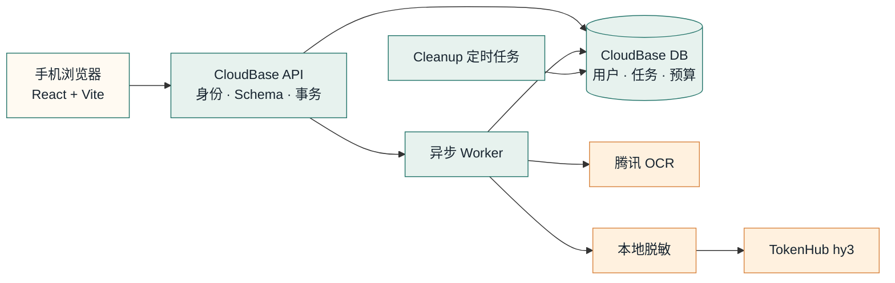

<div align="center">
  

  <h1>投了吗 · ApplyMate</h1>

  <p><strong>把真实经历，写进每一次开场。</strong></p>
  <p>一个面向实习、校招与初级岗位的移动端求职开场白助手。</p>

  <p>
    <a href="README.md">简体中文</a> ·
    <a href="README.en.md">English</a>
  </p>

  <p>
    <a href="https://github.com/Yinzhi392/ApplyMate/actions/workflows/ci.yml"></a>
    <a href="LICENSE"></a>
    
    
    
  </p>

  <p>
    <a href="#-三分钟了解-applymate">产品导览</a> ·
    <a href="#-本地开始">本地运行</a> ·
    <a href="CONTRIBUTING.md">参与贡献</a> ·
    <a href="SECURITY.md">安全反馈</a>
  </p>
</div>

---

## ✦ ApplyMate 是什么？

求职平台上的第一句话很短，准备它却经常很重复：重新读岗位、翻简历、挑经历、调整语气，然后再检查有没有写过头。

ApplyMate 把这段流程收进手机网页里：用户先确认简历事实，再提交岗位文字或截图；系统从已确认事实中选择证据，生成一段可以编辑、核对和复制的岗位专属开场白。

它不自动投递，也不替人编造经历。**模型负责表达，事实仍由用户掌握。**

## 📱 三分钟了解 ApplyMate

<table>
  <tr>
    <td align="center"><strong>01 · 先认识产品</strong></td>
    <td align="center"><strong>02 · 三步完成</strong></td>
    <td align="center"><strong>03 · 保持低焦虑</strong></td>
  </tr>
  <tr>
    <td></td>
    <td></td>
    <td></td>
  </tr>
</table>

> 截图来自当前 Web 主线的本地生产代码，不含真实简历、岗位或账号数据。

### 三步流程

1. **核对简历**：PDF、DOCX、图片或文字解析后，只有用户确认的事实才能进入生成。
2. **提交岗位**：粘贴 JD，或选择最多 5 张截图；手机端会先压缩，再异步处理。
3. **复制开场**：结果带 AI 标识，支持人工核对、编辑、复制与保存投递记录。

## 🧭 它认真做了什么

| 能力 | 不是一句口号，而是代码里的约束 |
|---|---|
| 事实可追溯 | 生成内容引用稳定 `factId`；未知事实、无来源数字和证据强度升级会被拦截 |
| 隐私最小化 | 原图只交给 OCR；文本在进入模型前本地遮盖手机号、邮箱、证件号和详细地址 |
| 异步可恢复 | API 快速返回 `jobId`；切后台、弱网重连或页面重建后可以继续查询任务 |
| 成本可控 | 预算预留、每日成功额度、并发限制、频率限制和失败释放在服务端事务中处理 |
| 多租户隔离 | 浏览器不能直读业务集合；每次查询都绑定服务端可信身份 |
| 有生命周期 | 支持 active、read-only、retired 三个服务阶段，并保留账号删除边界 |
| 移动优先 | 覆盖 320/390/430px，触控目标、软键盘、微信内浏览器和路由恢复都有测试 |

### ApplyMate 不做什么

- [x] 不自动投递，不模拟用户向招聘方发送消息
- [x] 不凭常识补写经历、技能、任期或成果数字
- [x] 不把原始简历或 JD 正文写进运行日志
- [x] 不在模型失败时偷偷切换备用模型或拼接“看似成功”的正文
- [x] 不把本地测试通过描述成正式生产已上线

## 🧩 架构一眼看懂



浏览器只依赖三个小接口：认证会话、临时上传和业务 API。OCR 与模型调用都留在 Worker；模型 ID、密钥与平台细节不会进入页面代码。更完整的边界说明见 [`memory-bank/architecture.md`](memory-bank/architecture.md)。

## 🚀 本地开始

### 环境要求

- Node.js `>=20 <25`
- npm `>=10`
- macOS、Linux 或 Windows + WSL

### 运行公开页面

```bash
git clone https://github.com/Yinzhi392/ApplyMate.git
cd ApplyMate
npm ci --ignore-scripts
cp web/.env.example web/.env.local
npm run web:dev
```

打开终端提示的本地地址，即可查看 `/`、`/legal` 和 `/support`。邮箱登录、上传和 AI 任务需要配置自己的 CloudBase 环境。

### 配置完整链路

`web/.env.local` 只放浏览器可公开的环境标识：

| 变量 | 用途 |
|---|---|
| `VITE_CLOUDBASE_ENV_ID` | 你的 CloudBase 环境 ID |
| `VITE_CLOUDBASE_REGION` | CloudBase 地域，默认 `ap-shanghai` |
| `VITE_API_FUNCTION_NAME` | 业务云函数名，默认 `api` |
| `VITE_JD_IMAGE_PROFILE` | 通过固定 A/B 后选择的图片压缩规格 |
| `VITE_PUBLIC_LAUNCH_AT` | 公开服务开始时间 |
| `VITE_AI_CLOSES_AT` | AI 功能关闭时间 |
| `VITE_DATA_ACCESS_ENDS_AT` | 数据访问结束时间 |

服务端密钥只能写入云函数环境变量，不能写进 `web/`、Git、日志或截图。CloudBase 的集合、权限、触发器和预算初始化请从 [`docs/web-cloudbase-setup.md`](docs/web-cloudbase-setup.md) 开始阅读。

> 当前仓库不是“一键部署 SaaS”模板。CloudBase、腾讯 OCR 与 TokenHub 都需要你自己的账号、额度和合规配置；公开源码不包含线上服务凭证或托管额度。

## 🗂️ 仓库地图

```text
web/                    React / Vite 移动 Web
shared/                 Schema、错误码与跨端领域规则
cloudfunctions/api/     身份、动作路由、事务与轻量读取
cloudfunctions/worker/  OCR、脱敏、生成、质量门与结果保存
cloudfunctions/cleanup/ 生命周期清理与任务预留释放
tests/                  单元、契约、集成、模型与浏览器测试
memory-bank/            当前产品、架构、计划与验证记录
miniprogram/            历史微信小程序源码归档
```

## ✅ 质量门

```bash
npm run typecheck       # 严格 TypeScript
npm run web:typecheck   # Web TypeScript
npm test                # Vitest
npm run web:build       # 生产构建与首屏体积门
npm run test:e2e        # 移动端浏览器回归
npm run check           # 完整门禁
```

测试 fixture 必须是合成或脱敏数据。真实简历、原始 JD 截图、生产导出、密钥和临时访问 URL 都不应进入 Issue、PR 或 Git 历史。

## 🌱 一起完善

欢迎提交 Bug、产品建议、文案改进和代码贡献。开始前请先阅读 [`CONTRIBUTING.md`](CONTRIBUTING.md)，尤其是事实真实性、隐私、模型成本和数据生命周期四个边界。

- 想找一个小切口？查看 [`good first issue`](https://github.com/Yinzhi392/ApplyMate/labels/good%20first%20issue)
- 发现安全或隐私问题？不要公开贴出复现数据，请按 [`SECURITY.md`](SECURITY.md) 私下报告
- 想了解接下来可能做什么？查看 [`ROADMAP.md`](ROADMAP.md)

## 📍 当前状态

Web v3 的本地实现、自动化门禁和旧预发布验证已经完成多个阶段；**独立生产环境、正式域名、备案、三类真机、30 次真实质量/隐私/时延验收与专业合规复核仍未全部完成**。

因此，这个仓库展示的是可审计的当前源码与验证证据，不是对线上可用性、生成效果或招聘结果的保证。最新的已验证状态记录在 [`memory-bank/progress.md`](memory-bank/progress.md)。

## 📄 许可证

代码以 [MIT License](LICENSE) 开源。使用第三方云服务、OCR 或模型时，你仍需遵守对应平台条款、数据保护要求与所在地区法律。

<div align="center">
  <p>如果这个方向对你有帮助，欢迎点一颗 ⭐，也欢迎把问题讲得具体一点。</p>
  <p><a href="mailto:applymate67@gmail.com">联系开发者</a> · <a href="https://github.com/Yinzhi392">GitHub</a></p>
</div>
