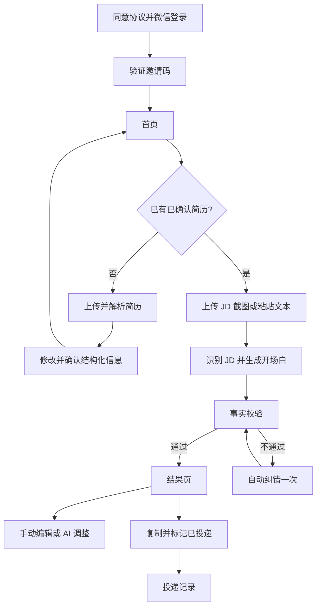
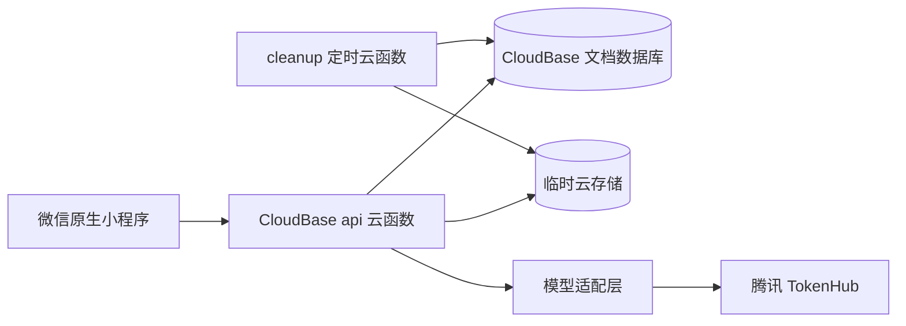

# 《投了吗》ApplyMate 产品与系统设计文档

**版本：** MVP v1.1
**日期：** 2026-08-05
**产品形态：** 微信原生小程序 + CloudBase
**目标阶段：** 30–100 人邀请制内测
**文档状态：** 本文档是 ApplyMate 产品需求与系统设计的唯一有效基线。

## 1. 设计目标

ApplyMate 解决“每次投递都要重复上传简历、通用 AI 容易忘记要求、平台默认问候语缺乏针对性”的问题。产品只做一个核心闭环：

> 用户确认一次简历，之后上传岗位 JD 截图，系统结合真实经历和求职偏好生成岗位专属开场白。

MVP 不做自动投递、招聘平台爬虫、批量岗位、简历自动重写、面试模拟、付费订阅和招聘方功能。

## 2. 产品原则

1. **真实优先：** 所有经历、技能、公司、学校、日期、年限和成果必须能回溯到用户确认的事实。
2. **移动优先：** 从招聘平台截图到复制文案，尽量减少页面切换和输入。
3. **隐私优先：** 原始文件只做临时处理，敏感信息在调用模型前遮盖。
4. **成本可控：** 邀请制、每日额度、成功才扣次、模型适配层和硬性费用上限。
5. **用户最终确认：** 生成文案可直接手动编辑；发送前必须由用户检查真实性。

## 3. 用户与额度

- 首发用户：寻找实习、校招或初级岗位的大学生和应届生。
- 每个账号最多保存 3 份结构化简历。
- 每日最多 5 次成功的首次生成或 AI 改写。
- 模型失败、输出校验失败和系统自动纠错不扣额度。
- 免费额度按北京时间每日 00:00 重置。

## 4. 信息架构

底部导航固定为：

1. **首页：** 当前简历、剩余额度、上传 JD、粘贴 JD、最近记录。
2. **记录：** 未投递/已投递记录、备忘、详情和删除。
3. **我的：** 简历、求职偏好、额度、协议、数据删除和管理员入口。

## 5. 页面设计

### 5.1 登录与邀请

- 展示产品名、口号和核心价值。
- 用户勾选协议和隐私政策后调用微信登录。
- 未激活用户输入一次性邀请码；邀请码默认 7 天过期。
- 禁用账号只能查看数据删除入口，不能继续调用 AI。

### 5.2 首页

- 顶部显示当前默认简历，可快速切换。
- 主按钮为“上传 JD 截图”，次入口为“粘贴 JD 文本”。
- 显示今日剩余次数及重置时间。
- 无已确认简历时可浏览首页，但点击生成必须先完成简历。
- 最近记录最多显示 3 条。

### 5.3 简历管理

- 支持 PDF、DOCX、图片/截图和粘贴文本，不支持旧版 DOC。
- 单文件不超过 10MB、最多 10 页；图片最多 6 张且压缩后总计不超过 10MB。
- AI 解析后展示教育、实习/工作、项目、技能、语言、证书和其他事实。
- 用户可修改、重命名、确认、设置默认和删除。
- 只有确认后的简历可以参与生成。

### 5.4 JD 生成流程

- 支持 1–6 张连续截图，可调整顺序。
- 处理状态为排队、识别中、生成中、校验中、完成或失败。
- 用户退出页面后，任务状态和结果仍可恢复。
- 首次成功自动创建“未投递”草稿。

### 5.5 结果页

- 展示公司、岗位、最新版开场白和 AI 生成标识。
- 文案默认 250–350 个中文字符、2–3 个自然段。
- 支持直接手动编辑，不扣额度。
- AI 快捷调整为：缩短、增加细节、换一种表达；另有自定义指令。
- 每次 AI 调整前提示将消耗 1 次额度。
- 匹配理由列出使用的 JD 要求、简历事实和未采用要求。
- 支持复制、标记已投递、备忘和满意/需改进反馈。

### 5.6 记录与我的

- 记录按更新时间倒序，MVP 状态仅为未投递、已投递。
- 同一记录只保存最新文案，不保留生成版本历史。
- “我的”包含三份简历、求职偏好、额度、隐私、删除账号。
- 管理员 OpenID 白名单用户额外看到邀请码、用户启停、额度和统计入口。

## 6. 视觉语言

- 气质：专业但不焦虑。
- 主色：低饱和青绿色；文字为深蓝灰；背景为暖白。
- 警告使用柔和橙色，不用焦虑式大面积红色。
- 标题和正文保持较大行距，主动作始终只有一个。
- 不展示未经真实数据支持的“成功率提升”宣传。

## 7. 系统架构

- 小程序不持有 TokenHub 密钥，也不能自行声明 OpenID。
- `api` 云函数按 action 路由业务，并从 CloudBase 运行上下文读取 OpenID。
- `cleanup` 云函数清理过期文件、草稿、幂等记录和审计日志。
- 数据库集合为 `users`、`invites`、`resumes`、`applications`、`ai_jobs`、`daily_usage`、`feedback` 和 `audit_logs`。

## 8. AI 模型与适配

- 多图主模型：`youtu-vita`。
- 单图备用：`hy-vision-2.0-instruct`。
- 文本生成和改写主模型：`deepseek-v4-flash`。
- 文本质量备用：`hy3`。

业务层只调用 `parseResume`、`generateGreeting`、`rewriteGreeting`，不直接依赖提供商响应格式。模型名称、超时、重试和启停均来自服务端配置。

## 9. 结构化简历与事实边界

每一项教育、经历、项目、技能、证书和可验证成果都分配稳定 `factId`。生成结果的 `evidence` 必须引用存在的 `factId`。用户修改事实后，系统重新计算事实文本哈希，旧任务不能继续引用已经删除的事实。

敏感信息遮盖范围包括手机号、邮箱、身份证号、详细地址和其他证件号码。姓名、学校和公司可以保留用于匹配，但不得被模型写成不存在的关系或成果。

## 10. 生成契约与质量门

首次生成返回：

- `jobDescription`
- `greeting`
- `evidence[]`
- `omittedRequirements[]`
- `warnings[]`

本地质量门检查：

1. 结构与字段完整。
2. 开场白长度和段落符合要求。
3. 所有 `factId` 存在且属于当前简历。
4. 数字、日期、年限、学校、公司和技能不得超出被引用事实。
5. 不得出现手机号、邮箱、模型自述和提示词泄漏。
6. 截图与 JD 文本一律视为资料，不得覆盖系统指令。

硬性失败时以已提取 JD 文本自动纠错一次；再次失败则释放额度并返回错误。

## 11. 文件与数据生命周期

- 已确认简历原文件立即删除，仅保留结构化数据。
- JD 图片任务结束后立即删除；异常残留最长 1 小时。
- 未确认简历草稿最长保留 24 小时。
- AI 审计日志保存 180 天，只含元数据和哈希。
- 删除账号后立即禁用，24 小时内物理删除个人数据。

## 12. API 契约

统一请求为 `{ action, payload, requestId }`，统一响应为 `{ ok, data?, error? }`。写操作必须携带 UUID 形式的 `requestId`，服务端使用 OpenID 与 requestId 做幂等去重。

主要 action：

- `auth.status`、`invite.activate`、`user.get`、`user.delete`
- `resume.parse`、`resume.confirm`、`resume.list`、`resume.setDefault`、`resume.delete`
- `generation.create`、`generation.get`、`generation.rewrite`
- `application.list`、`application.get`、`application.update`、`application.delete`
- `feedback.submit`
- `admin.inviteCreate`、`admin.inviteRevoke`、`admin.userSetEnabled`、`admin.quotaAdjust`、`admin.stats`

## 13. 额度与并发

每日用量文档维护 `reserved` 和 `succeeded`。请求开始在事务中预留额度，成功后转为成功次数，失败后释放。`reserved + succeeded` 不得超过 5，避免并发请求绕过限额。

同一 requestId 的重复请求返回原结果，不产生重复记录或重复 AI 调用。

## 14. 错误处理

- 文件不支持：说明可用格式，不上传模型。
- 扫描 PDF 无法渲染：提示用户改传页面截图。
- 图片不清晰：保留任务失败原因并允许替换图片。
- 模型超时/429：自动退避重试一次，再尝试备用模型。
- 输出不真实：自动纠错一次；仍失败则不扣额度。
- 额度耗尽：显示北京时间重置时间，不引导付费。
- 权限失败：统一返回无资源存在的表现，避免泄漏他人数据。

## 15. 指标与验收

- 首份简历确认率 ≥60%。
- 生成成功率 ≥95%。
- 首次生成中位数 ≤10 秒，P95 ≤20 秒。
- 复制率 ≥60%，满意反馈 ≥70%。
- 成功生成用户 7 日回访率 ≥25%。
- 平均成功生成成本 ≤0.05 元。
- 30 组发布评测中不得出现无依据经历、技能、年限或成果。

## 16. 上线门槛

1. 在微信后台验证个人主体服务类目；受限时升级个体工商户或企业主体。
2. 准备用户协议、隐私政策、AI 生成内容标识、模型信息公示和删除机制。
3. 关闭 TokenHub 自动后付费，配置费用告警。
4. 完成 iOS/Android 真机、弱网、跨用户隔离和账号删除演练。
