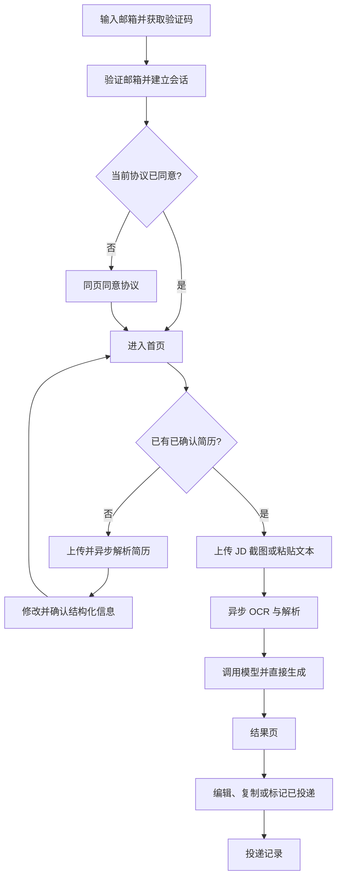
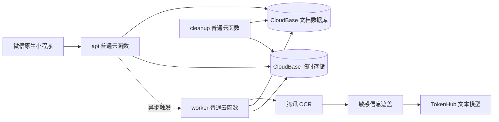

# 《投了吗》ApplyMate 产品与系统设计文档

**版本：** Web MVP v2.0

**日期：** 2026-08-23

**产品形态：** 移动端优先 Web/PWA + CloudBase

**目标阶段：** 30–100 人邮箱登录测试

**文档状态：** 本文档是 ApplyMate 产品需求与系统设计的唯一有效基线。2026-08-22 起微信小程序代码冻结为 Legacy，只读保留且不迁移既有数据；下文仍提及微信/OpenID/原生页面的段落均为历史设计，不再约束 Web v2.0。

## 0. Web v2.0 生效范围

- 首期为 30–100 人移动 Web 测试版，不使用邀请码，不采集手机号、姓名或自建密码；用户只向 CloudBase 身份服务提交邮箱和验证码。
- 首次访问使用邮箱验证码登录；CloudBase Web SDK 以 `local` 持久化会话，同一浏览器后续自动恢复。会话失效、清除站点数据或更换设备后，可再次用同一邮箱验证码登录原账号。
- 服务端只信任 CloudBase 运行时提供的 Web UID。无论该 UID 被标记为注册邮箱还是 Web 匿名兼容命名空间，只要账号启用且当前协议有效，就直接进入产品，不再经过旧小程序邀请码状态；微信 OpenID 的 Legacy 规则不得影响 Web 路由。
- 服务端从可信认证上下文区分注册邮箱身份与 Legacy 匿名身份，并以 `web-email-uid-v1` 或 `web-anonymous-uid-v1` 命名空间哈希为内部 `userId`。客户端提交的 UID、邮箱、OpenID、userId 和文件所有者字段全部忽略；业务数据库不保存邮箱明文。
- 每个用户最多保存 3 份已确认简历；北京时间每天可成功处理 20 份新 JD。失败、自动重试、编辑、复制和同一结果的改写不扣新 JD 次数。
- Web 保留简历、偏好、JD 截图/文字、异步生成、任务恢复、结果编辑/复制/改写、记录、反馈、账号删除、管理员、协议和 AI 服务说明。
- 旧小程序与旧数据不删除、不迁移；只有得到单独授权后才能对 Legacy 数据执行任何变更。

### 0.1 Web 信息架构

Web 路由固定为 `/login`、`/`、`/resumes`、`/resumes/new`、`/resumes/:id/review`、`/preferences`、`/jobs/new`、`/jobs/:jobId`、`/results/:applicationId`、`/records`、`/records/:id`、`/account`、`/legal` 和 `/admin`。首页、记录和账户使用移动端底部导航；流程页使用返回动作。

### 0.2 Web 交互与视觉

- 以 320、360、390、430px 为首要验收宽度；页面不使用固定高度，使用 `dvh`、安全区和自然滚动。
- 页面边距 16px，模块间距 24–32px，触控目标至少 44px；一级表面允许克制玻璃效果，禁止嵌套卡片、横向滚动、文字裁切和按钮溢出。
- 岗位截图选择后立即预览，可在后台上传，但只有用户点击“生成开场白”后才创建正式 OCR/模型任务。
- 结果页只突出正文、编辑、复制、保存、改写、“继续投下一个岗位”和“返回首页”，不展示匹配依据、遗漏项和内部校验信息。
- PWA 只缓存网站外壳，不缓存简历、JD、结构化事实、生成正文、任务响应或任何用户内容。

### 0.3 Web 隐私与 AI 边界

- 简历原件只进入 CloudBase 和腾讯 OCR；脱敏文本才可进入文本模型。确认后删除原文件，未完成草稿最多保留 24 小时。
- Web 用户上传文件后，由文件创建者身份立即取得 CloudBase 短期 HTTPS URL。业务 API 必须把该 URL 严格绑定到同一 `fileId` 的 bucket 与对象路径后才可交给 worker；worker 不得依赖自身身份读取用户私有文件，任务终态后必须清除短期 URL 并删除原件。
- JD 截图可在明确告知后发送给最终评测通过的多模态提供方；豆包、TokenHub 或通义均不得预设免费，必须先确认免费额度、关闭后付费并验证实际账单为 0 元。
- 正文统一使用“贵司该岗位”；公司和岗位名称只作为可编辑记录元数据，识别失败不阻断正文生成。
- 模型 JSON 失败时尝试提取可读正文；仅正文为空、包含未遮盖隐私或外部服务不可用时阻断。匹配依据、元数据或格式不完整不得导致整单失败。
- 复制内容继续附加“AI生成内容，请核对真实性”；联系邮箱固定为 `applymate67@gmail.com`。

## 1. 设计目标

ApplyMate 解决“每次投递都要重复上传简历、通用 AI 容易忘记要求、平台默认问候语缺乏针对性”的问题。MVP 只完成一个核心闭环：

> 用户确认一次简历，之后上传岗位 JD 截图或文本，系统依据已确认事实与求职偏好生成岗位专属开场白。

MVP 不做自动投递、招聘平台爬虫、批量岗位、简历自动重写、面试模拟、付费订阅和招聘方功能。

## 2. 产品原则

1. **真实优先：** 每项可验证陈述必须回溯到用户确认的简历事实、求职偏好或 JD 字段。
2. **隐私优先：** 原图只发送给腾讯 OCR；TokenHub 只接收脱敏文本。
3. **移动优先：** 从招聘平台截图到复制文案，尽量减少输入和页面切换。
4. **严格零付费：** OCR、模型、云函数、存储和流量均不得产生实际费用；免费额度耗尽即暂停相应入口。
5. **用户最终确认：** 用户可以编辑并复制文案；系统必须提示核对真实性，但不替用户完成投递。

## 3. 用户、准入与额度

- 首发用户为寻找实习、校招或初级岗位的大学生和应届生。
- 用户首次使用邮箱验证码登录并同意当前协议；后续同一浏览器自动恢复登录。登录用户无需邀请码即可进入产品。
- 管理员身份哈希必须存在服务端白名单中，同意协议后可进入管理员页；客户端声明的管理员标记无效。
- 每个账号最多保存 3 份已确认结构化简历。
- 北京时间每日默认最多处理 20 份成功的新 JD；失败、超时、自动重试不扣，安全通用版成功扣一次。同一结果的改写不占新 JD 次数，但使用独立频率限制。
- `admin.quotaAdjust` 只能增加当日临时次数，次日北京时间 00:00 失效，并记录管理员、数值、原因和时间。
- 任一外部服务免费额度耗尽时暂停对应 AI 入口，不允许自动开通后付费或更换平台。

## 4. 信息架构与主流程

底部导航固定为“首页／记录／我的”。登录、简历、生成和结果为流程页面，不占用底部导航。

## 5. 页面与交互

### 5.1 邮箱登录与协议

- 首次用户在同一页面输入邮箱、获取 6 位字母或数字验证码、勾选协议并完成登录；不显示或校验邀请码。
- 验证码发送、倒计时和登录提交均防止重复点击；邮箱或验证码错误在原页显示，用户输入保持不丢失。
- CloudBase SDK 使用本地会话持久化。同一浏览器有有效会话且协议版本有效时直接进入首页；会话失效后允许用同一邮箱验证码重新登录原账号。
- 协议版本发生实质变化时只要求重新同意，不要求再次输入邀请码或创建新业务账号。
- 业务数据库不得保存邮箱明文，服务端只保存可信 CloudBase UID 的命名空间哈希。禁用账号在登录页显示受限状态和联系入口。

### 5.2 首页

- 只显示当前默认简历、今日剩余次数和一个“提交岗位信息”主入口；最近投递只在“记录”中展示。
- 问候固定为“你好，同学 👋”，不展示真实姓名或姓氏；问候、当前简历和额度合并为顶部状态区，岗位入口占满内容宽度，三步事实流程紧随主入口并收进一个连续分组区域，形成稳定纵向节奏，不用大段空白强行分隔模块。
- 顶部状态区的“管理简历”固定在右上操作位；说明“准备好后，直接提交一个岗位。”保持单行，不能因右侧操作的位置而提前换行。
- 无已确认简历时可浏览，但生成前必须先确认简历。
- 额度或外部免费资源耗尽时明确说明暂停原因及恢复条件，不展示付费引导。

### 5.3 简历管理

- 支持 PDF、DOCX、图片/截图和粘贴文本，不支持旧版 DOC。
- 上传页顶层只区分“上传文件”和“粘贴文字”；上传文件内可直接选择 PDF/DOCX 或改用最多 6 张图片，不要求用户先判断四种技术类型。
- 单文件不超过 10MB；PDF 最多 10 页；图片最多 6 张且总计不超过 10MB。
- 提取或粘贴的文本最多 20,000 个可见字符；求职偏好最多 500 个可见字符。
- 文本型 PDF 和 DOCX 在服务端提取文字；扫描型 PDF 提示改传页面截图。
- 图片与页面截图只发送至腾讯 OCR，OCR 结果脱敏后才可交给 TokenHub。
- 简历确认不取消，但改为一次性的轻量“核对个人资料”：AI 负责识别、归类和排序，用户只需对事实执行正确、修改或删除，不填写主观能力评分。
- 核对页顶部展示 AI 初步判断的三个主要加分项；低置信或可能识别错误的事实默认展开，其余事实按教育、实习/工作、项目、技能、语言、证书和其他类别收纳。
- 核对页可在“实习/工作经历、项目经历、专业技能与工具”标签后使用少量语义 Emoji，帮助快速扫读；修改、删除与“正确”操作必须在同一等宽操作行内水平、垂直居中，并保持至少 88rpx 触控高度。
- 初始市场基准权重固定为：相关实习/工作 25%、相关项目与量化成果 25%、专业技能与工具 20%、有经历支撑的个人能力 15%、教育背景与专业匹配 8%、证书/语言/奖项/领导经历 5%、GPA/均分 2%。权重只用于排序，不代表录用概率。
- GPA/均分默认低权重；金融、咨询、量化、研究或 JD 明确要求成绩时可提高。学历、专业、毕业时间、到岗安排和地点等硬条件应单独核对，不能用加分权重掩盖不满足条件。
- 沟通、协作、主动性、解决问题等个人能力只能从已确认经历中推断并引用事实来源，不允许生成无证据的“责任心强”等自我评价。
- 用户确认简历后，后续提交每个 JD 时由 AI 根据岗位要求重新排序已确认事实，不再要求用户重复确认简历。
- 只有已确认简历可参与生成；确认后立即删除原文件。
- 简历列表只保留一个“添加一份简历”入口。每份简历以完整状态项展示，默认标识紧邻名称；操作统一进入“···”原生菜单：待确认简历提供继续核对和删除，非默认简历提供设为默认和删除，默认简历只提供删除。删除始终二次确认。

### 5.4 JD 生成流程

- 默认进入截图模式，支持一次或分批追加 1–5 张连续截图，不区分“岗位介绍”和“岗位要求”。
- 截图显示顺序编号，可删除并通过长按拖动调整顺序；切换至文字模式时保留截图草稿，切回后继续使用。
- 文字模式支持粘贴最多 20,000 个可见字符的文本，并与截图草稿分别保留；只有当前模式的内容会提交。
- 截图、文字、顺序、删除或本次简历发生变化后必须重置幂等请求标识，避免修改后的输入复用旧请求。
- 用户不需要单独填写或确认岗位名；系统从 JD 中自动提取。岗位名无法可靠识别时使用“该岗位”，公司名缺失时使用“贵司”，并在结果页展示提醒。
- JD 提交后直接进入生成，不设置 JD 二次确认步骤。岗位名和公司名缺失时分别使用“该岗位”和“贵司”。首次生成不再以事实映射或字段置信度阻断模型正文；Prompt 负责根据当前 JD 和已确认资料完成匹配。
- 图片或文字几乎无法识别、没有足够岗位职责或要求时，任务直接失败并提示重新提交，不扣用户额度，不进入确认页面。
- 生成任务固定状态为：排队、OCR、解析、生成、校验、成功、失败；“等待用户确认”只用于简历解析后的事实确认，不用于 JD。
- 简历解析与文案生成均为异步任务，页面退出、前后台切换或重复查询后可恢复。

### 5.5 结果页

- MVP 始终生成简体中文。
- 首屏优先展示正文、复制和保存；状态、备忘和反馈位于次级可展开区域。匹配依据、未采用要求、提醒和 AI 改写不再展示；服务端 evidence 仅作尽力而为的审计元数据，不参与首次正文阻断。
- 结果页标题固定为“专属开场白”，首屏提供正文、复制和保存；“我的”使用分组列表展示资料、使用情况、隐私与账号，不设置装饰性身份卡片。
- 结果页底部提供双路径：主操作“继续投下一个岗位”会先保存未保存正文，再清空岗位图片、文字草稿和 requestId，重新读取当前默认简历并重建岗位提交页面；次操作“返回首页”同样先保存未保存正文，再切换至首页。保存失败必须停留原页并提示错误。
- AI 正文固定为 350–450 个可见字符和 3–4 个非空段落；标点计入，空白不计入。正文应自然包含“您好”，但不要求独立固定首句；结尾根据岗位、匹配模式和到岗条件自适应，不使用固定公式。
- 支持手动编辑；现有 AI 改写服务仅为历史兼容保留，体验版结果页不提供改写入口。
- 手动编辑超出长度/段落要求或加入无证据事实时只显示警告，不阻止保存或复制。
- 复制时在正文后另起一行附加“AI生成内容，请核对真实性”；该标识不计入正文长度。此显式标识要求依据现行人工智能生成合成内容标识规定执行。[国家网信办说明](https://www.cac.gov.cn/2025-03/14/c_1743654685896173.htm)
- 匹配证据继续逐项保存在服务端投递快照中，不在结果页展示。

### 5.6 记录、反馈与“我的”

- 投递记录按更新时间倒序，状态仅为未投递、已投递；同一记录只保留最新文案。
- 记录保存生成当时引用的脱敏事实和 JD 快照；修改或删除简历不影响既有记录。
- 每条记录保留一条可覆盖反馈，可选“满意/需改进”，说明最多 500 个可见字符。
- “我的”包含简历、求职偏好、额度、协议、隐私和删除账号；管理员额外看到受保护入口。页面标题可使用一个克制的问候 Emoji；简历管理、求职偏好、协议与隐私和删除账号四个可操作入口均使用对应语义图标，图标贴近卡片左侧，数量或操作文字统一贴近右侧；只读的使用情况行不增加装饰图标。
- “协议与隐私”打开一页可复用原生页面，用户可切换用户协议、隐私政策和 AI 服务说明，查看版本、生效日期、同意时间并复制全文。用户协议与隐私政策版本固定为 `user-2026-08-09` 和 `privacy-2026-08-09`，联系邮箱为 `applymate67@gmail.com`；当前文本已由产品负责人确认用于 30 至 100 人邀请制体验版，公开发布前仍须专业复核。
- 删除账号须二次确认，确认后不可撤销：立即禁用，24 小时内删除全部可关联数据，仅保留无法重新关联用户的匿名聚合指标。

## 6. 视觉与线框门槛

- 气质专业但不焦虑；主色为低饱和青绿色，文字为深蓝灰，背景为暖白。
- 警告使用柔和橙色，不用焦虑式大面积红色；每页保持一个主动作。
- 采用 A“克制玻璃”清爽效率型单列布局：允许半透明暖白表面、亮色细描边、轻微内高光、克制青绿色阴影和少量静态背景光斑；减少嵌套卡片，模块间使用明确留白，不增加装饰性动画。
- 微信小程序只用原生 WXSS 模拟层次感，不依赖 Apple SwiftUI Liquid Glass API、`backdrop-filter`、高成本模糊或持续动画；不支持效果时仍以实色暖白表面、边框和间距保证信息层级。
- 微信开发者工具中的原生渲染是阶段 9 唯一视觉验收基准；浏览器静态稿只用于确认结构、文案和设计方向，不能证明小程序没有溢出或平台差异。
- 关键横向布局使用可收缩的 Flex，不依赖页面级 CSS Grid、`minmax()`、`repeat()` 或关键 `@media` 补丁；按钮子项必须设置弹性宽度、`min-width: 0` 和容器边界。
- 阶段 9 的 13 个业务页面各自维护页面级 WXSS；阶段 10 新增一个可复用协议页面后，生产路由共 14 页。全局只承载颜色、字号、间距、圆角、状态、88rpx 触控高度和安全区基础规则。
- 不展示未经真实数据支持的成功率宣传。
- 阶段 9 视觉返工必须先交付仓库内可长期查看的 13 页静态交互视觉稿，使用合成数据且不连接云服务；视觉稿确认前不得修改原生页面。
- 13 页为登录、首页、简历列表、简历上传、简历确认、求职偏好、岗位提交、任务进度、结果、记录、记录详情、“我的”和管理员；不设置 JD 确认页。
- 统一页面边距 32rpx、模块间距 48rpx、内容间距 20rpx、控件最小高度 88rpx；每页只突出一个主操作，不得用嵌套卡片代替信息结构。
- 320px、375px 和 390px 宽度下不得出现横向滚动、按钮裁切或内容越过 32rpx 页面边距；长按钮文案最多换两行。原生稳定等效优先于与浏览器稿逐像素一致。
- 视觉稿确认后才按确认稿重写 WXML/WXSS；完成后必须在微信开发者工具逐页截取 13 页并进行新旧对照，不能以“存在 WXSS”作为视觉验收。

## 7. 系统架构

- `api` 从 CloudBase 上下文读取可信 OpenID，完成鉴权、输入校验、任务创建和查询；任务落库后使用 SCF Event 异步触发 `worker`。`generation.create` 不等待任务终态，只返回 `jobId`；成功的 `job.get` 返回本人 application 的安全首屏预览，API 自身不执行 OCR 或模型。
- `worker` 执行 OCR、结构化解析和生成。首次岗位生成只调用一次文本模型，再执行本地真实性、隐私与 350–450 字/3–4 段格式检查；失败不追加模型调用，也不使用本地通用正文回退。
- `cleanup` 处理残留文件、10 分钟无终态任务、过期幂等记录和待删除账号。
- 单次 worker 任务最多运行 45 秒；超过 10 分钟仍无终态的任务由 cleanup 标记失败并释放额度。
- 所有服务严格使用免费资源；创建或开通微信、CloudBase、OCR、TokenHub 资源必须逐项取得授权。
- CloudBase 体验版使用同名 `api`、`worker`、`cleanup`。开发者/体验成员默认进入真实 CloudBase 链路：文件上传到 `temporary/` 云存储，`api` 创建任务，`worker` 调用腾讯 OCR、遮盖敏感信息并调用 TokenHub Hy3，终态后清理临时文件。`APPLYMATE_REAL_AI_ENABLED` 缺失、免费额度不足或模型信息不完整时失败关闭；显式 demo 仅用于合成界面测试。
- JD 选图后立即后台上传原图，最多 3 张并发；每图独立记录状态与 fileId，单图失败只重试该图，删除尽力清理，排序不重新上传。全部上传成功后才允许生成。worker 一次批量取得全部签名 URL，再并行 OCR 并按用户排序合并；只有 URL/OCR 传输失败的图片才在云端生成 720×1080、质量 80 副本并重试一次。

## 8. OCR、模型与适配边界

- 所有简历图片和 JD 截图只进入 CloudBase 临时存储和腾讯 OCR。正常路径把短期签名 URL 交给 OCR；仅对应图片 URL/OCR 传输失败时生成 720×1080、JPEG 质量 80 副本重试。OCR 结束后删除原图与副本；TokenHub 只接收脱敏文本。
- 文本运行方案固定为 Hy3 一次返回结构化 JD、`strong | partial | low` 匹配模式、紧凑证据计划和自然开场白。本地对未知 factId、数字来源、目标称呼、隐私、350–450 个可见字符和 3–4 段执行失败关闭；不得调用第二个模型或生成机械通用正文。当前 Prompt 版本仍为 `experience-evidence-planned-v8`。
- YT-VITA 和 HY-Vision 不进入运行时主流程。
- 业务层只调用 `parseResume`、`generateGreeting` 和 `rewriteGreeting`，不得直接依赖提供商响应格式或 Model ID。
- 外发前遮盖手机号、邮箱、身份证号、其他证件号和详细地址；日志不保存原始 Prompt、简历、JD 或截图。
- 30 组样本由 AI 起草样本与真值，产品负责人逐组确认后才允许用于模型评测。

## 9. 结构化事实与生成契约

- 每项教育、经历、项目、技能、证书、量化成果和求职偏好均有稳定 `factId`。
- 求职偏好按用户确认的句子或换行拆分，每项来源类型固定为 `preference`。
- JD 的岗位名、公司、职责、技能、经验/教育、地点/工作方式和到岗/时长要求均有稳定字段标识。
- 每项可验证陈述都必须逐项映射到一个或多个有效 `factId` 或 JD 字段，不能只返回整篇共用证据列表。
- 生成结果至少包含结构化 JD、正文、逐项陈述证据、未采用要求和警告。
- 用户修改事实后更新事实哈希；新生成不得引用已删除事实，历史记录使用当时的脱敏快照。
- 人工质量基准固定为三条合成金标准：战略投资 `strong`、金融 AI Agent 产品经理 `strong`、SEO 经理 `partial`。三条路线分别约束完整专业项目不可被弱化、岗位核心职能不可被行业词带偏，以及缺少直接经验时必须承认缺口并准确映射可迁移能力。

## 10. 单次模型与本地质量门

首次生成保存规则：

1. Schema 和生成所需内容完整；岗位名无法可靠识别时使用“该岗位”，公司缺失时使用“贵司”，两者均产生提醒。
2. 首次生成正文为 350–450 个可见字符和 3–4 个非空段落，自然包含“您好”，不固定首句或结尾；历史改写服务仍使用独立入口契约，但当前结果页不提供入口。
3. `factId`、JD `fieldId` 和证据层级用于生成后的尽力审计；模型不得引用未确认的 factId，正文中的数字必须能在当前 JD 或已确认事实中找到来源。
4. 本地质量门固定检查 350–450 个可见字符、3–4 个非空段落、问候、岗位/公司目标、联系方式和未替换敏感占位符。
5. 未知事实引用、无来源数字、格式、隐私或空/无法读取输出均失败关闭，返回安全且可操作的错误原因并释放额度。
6. 首次生成严格只调用 Hy3 一次；任何模型或本地质量门失败都不追加第二次模型调用。
7. 不使用 `verified_generic_fallback` 或其他机械通用正文，不以“格式成功”掩盖没有输入依据的内容。

## 11. 任务、API 与幂等

统一请求为 `{ action, payload, requestId }`，统一响应为 `{ ok, data?, error? }`。所有写操作必须携带 UUID `requestId`；同一用户、同一 requestId、同一负载返回原结果，不得重复写入或扣次；负载不同则返回冲突。终态幂等记录保留 24 小时。

主要 action：

- `auth.status`、`agreement.accept`、`user.get`、`user.updatePreferences`、`user.delete`
- `resume.parse`、`resume.confirm`、`resume.list`、`resume.setDefault`、`resume.delete`
- `generation.create`、`generation.rewrite`
- `job.get`
- `application.list`、`application.get`、`application.update`、`application.delete`
- `feedback.submit`
- `analytics.track`，只允许 `app_opened` 或剪贴板成功后的 `greeting_copied`，不接收正文
- `admin.userSetEnabled`、`admin.quotaAdjust`、`admin.stats`

`resume.parse` 返回 `jobId`。`generation.create` 在有界终态窗口内成功时返回 `applicationId`，否则返回 `jobId`；`job.get` 是解析与生成任务的统一查询入口。生成任务不会暂停等待 JD 确认；可用字段直接生成，不可靠字段省略，内容不足则失败并要求重新提交。

## 12. 数据、额度与生命周期

数据库集合为 `users`、`resumes`、`applications`、`ai_jobs`、`daily_usage`、`feedback` 和 `audit_logs`；`invites` 仅为 Legacy 历史集合，Web 邮箱登录不再读取或写入。

- 每日额度事务维护 `reserved`、`succeeded` 和当日临时增加次数。
- 进入实际生成前预留额度；成功后转为成功次数；模型、校验或系统失败时释放。v8 生成/改写不进行模型重试；简历解析的内部备用尝试不占用生成额度。
- 已确认简历原文件立即删除；JD 图片处理完成后立即删除，异常残留最长 1 小时。
- 未确认简历草稿和简历解析后的等待确认任务最多保留 24 小时。
- AI 与审计日志最多保存 180 天，只保存模型、耗时、Token、估算成本、Prompt 版本、状态和内容哈希；账号删除时先删除或不可逆匿名化其中的用户关联。
- 新生成和改写的投递记录保存实际成功模型的提供方、模型名、Model ID、Prompt 版本、运行模式和备案/登记引用；历史缺失显示“生成信息不可用”，演示模式显式说明未调用真实 OCR 或模型。
- 产品参与度不新增事件集合，只在用户记录保存首次/最近打开、首次复制和首次命中 7 日窗口的时间。客户端失败队列最多 20 条，只含事件名和可选 applicationId；复制事件必须在微信剪贴板成功后记录。
- 邮箱验证码的发送频率、有效期和错误次数由 CloudBase 身份服务限制；业务 API 不接收验证码或邮箱，也不自建邮件发送与密码系统。
- 协议记录保存协议类型、版本、同意时间和用户标识。
- 投递历史中的脱敏事实与 JD 快照随账号删除一并删除，不得恢复。

## 13. 错误与降级

- 文件格式、大小、页数或文本长度不合法时在外发前拒绝，并说明修正方式。
- 扫描型 PDF 无文字时提示改传页面截图；低清图片提示替换。
- OCR 或模型超时、429、免费额度耗尽时不扣用户额度；免费资源耗尽后暂停对应入口。
- 公司、岗位名或职责字段缺失时分别使用“贵司”“该岗位”“岗位相关职责与要求”，不因非核心 JD 字段缺失阻断生成。
- 首次生成对未知事实引用、无来源数字、目标称呼、350–450 个可见字符、3–4 段和隐私格式失败关闭；不使用 `verified_generic_fallback`。失败返回可操作原因并释放额度，不发起第二次模型调用。
- OCR 完全无文字、文件损坏、凭证不可用或免费额度耗尽仍必须明确失败，不能用通用正文掩盖没有输入依据的情况。
- 任务状态只能按既定状态机推进；重复 worker、回调或 cleanup 操作必须幂等。
- 权限失败统一表现为资源不存在，避免泄露其他用户数据。
- 任何零付费前提不能满足时，阶段 0 立即停止，不得擅自启用付费或更换平台。

## 14. 指标与验收口径

- 首份简历确认率 ≥60%：已激活唯一用户中，在激活后 168 小时内确认首份简历的用户占比。
- 生成成功率 ≥95%：进入实际生成状态的唯一任务中成功任务占比；用户取消和等待确认不计入分母。
- 选图完成到正文首次展示 P50 ≤15 秒、P95 ≤20 秒；点击“识别并生成”到正文首次展示 P50 ≤10 秒、P95 ≤15 秒。子预算为后台上传 ≤4 秒、API 创建 ≤1 秒、OCR ≤2 秒、模型 ≤5.5 秒、校验保存与首屏 ≤1.5 秒；必须以新版 iOS/Android、Wi-Fi/移动网络真机计时验收。
- 任务和 application 只记录非内容的后台上传、API 创建、排队、签名/OCR、模型、校验、最终结果拉取、选图/任务到预览耗时和管线版本；预览指标在正文已展示后异步上报，不得阻塞首屏。
- 复制率 ≥60%：至少成功生成一次的唯一用户中，至少复制一次的用户占比。
- 满意反馈 ≥70%：按投递记录去重后的有效反馈中“满意”占比。
- 7 日回访率 ≥25%：成功生成用户中，在首次成功后的北京时间第 2–7 日再次打开产品的唯一用户占比；成功当天为第 1 日，计算偏移 1–6 个自然日。
- 30 组评测关键字段准确率 ≥90%、文案合规率 ≥95%、无虚构事实；关键字段按字段级统一计分。
- 成本统计覆盖 OCR、TokenHub、云函数、存储请求和流量；估算平均成功生成成本 ≤0.05 元，实际账单费用必须为 0 元。

关键字段固定为岗位名、职责、硬技能、经验/教育、地点/工作方式、到岗/时长要求。所有比率同时返回分子、分母和比率，分母为零时比率为 `null`；管理员白名单和合成测试账号不进入产品指标。正式字段准确率仅可在恰好 30 组样本全部人工确认后计算，不能用草案或部分样本生成正式结论。

## 15. 前置验证与发布门槛

1. 产品负责人逐组确认 30 组脱敏样本与真值；未确认不得开始模型评测。
2. 逐项取得授权后，验证微信个人主体类目、CloudBase、腾讯 OCR 和 TokenHub 的可用性及严格零付费配置。
3. 捕获完整外发链路，证明原图只到 OCR，TokenHub 请求不存在手机号、邮箱、证件号和详细地址。
4. 验证异步重复请求、前后台恢复、45 秒上限、10 分钟回收、额度释放和跨用户隔离。
5. UI 编码前确认七个低保真线框；发布前由产品负责人提供至少一名 iOS 和一名 Android 真机测试者。
6. 用户协议和隐私政策可由 AI 起草、产品负责人确认后用于邀请制内测；公开发布前必须专业复核。
7. 个人主体类目受限时仅继续开发者工具和体验版测试，不升级主体、不转 H5、不正式发布。
8. 当前无 Git 远程时执行本地完整检查；配置 GitHub 后再增加 CI。
