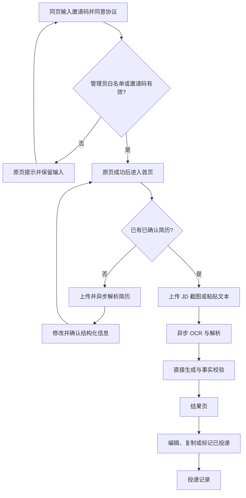
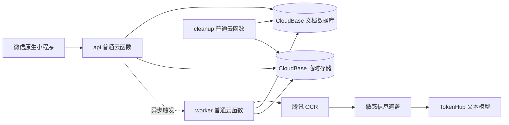

# 《投了吗》ApplyMate 产品与系统设计文档

**版本：** MVP v1.14

**日期：** 2026-08-09

**产品形态：** 微信原生小程序 + CloudBase

**目标阶段：** 30–100 人邀请制内测

**文档状态：** 本文档是 ApplyMate 产品需求与系统设计的唯一有效基线。

## 1. 设计目标

ApplyMate 解决“每次投递都要重复上传简历、通用 AI 容易忘记要求、平台默认问候语缺乏针对性”的问题。MVP 只完成一个核心闭环：

> 用户确认一次简历，之后上传岗位 JD 截图或文本，系统依据已确认事实与求职偏好生成岗位专属开场白。

MVP 不做自动投递、招聘平台爬虫、批量岗位、简历自动重写、面试模拟、付费订阅和招聘方功能。

## 2. 产品原则

1. **真实优先：** 每项可验证陈述必须回溯到用户确认的简历事实、求职偏好或 JD 字段。
2. **隐私优先：** 原图只发送给腾讯 OCR；TokenHub 只接收脱敏文本。
3. **移动优先：** 从招聘平台截图到复制文案，尽量减少输入和页面切换。
4. **严格零付费：** OCR、模型、云函数、存储和流量均不得产生实际费用；免费额度耗尽即暂停相应入口。
5. **用户最终确认：** 用户可以编辑并复制文案；系统必须提示核对真实性，但不替用户完成投递。

## 3. 用户、准入与额度

- 首发用户为寻找实习、校招或初级岗位的大学生和应届生。
- 用户同意当前版本协议后通过微信身份登录；未激活用户须使用邀请码。
- 管理员 OpenID 白名单用户同意协议后免邀请码进入，用于创建首批邀请码。
- 每个账号最多保存 3 份已确认结构化简历。
- 每日默认最多 5 次成功的首次生成或 AI 改写；失败、自动纠错和等待确认不扣次。
- `admin.quotaAdjust` 只能增加当日临时次数，次日北京时间 00:00 失效，并记录管理员、数值、原因和时间。
- 任一外部服务免费额度耗尽时暂停对应 AI 入口，不允许自动开通后付费或更换平台。

## 4. 信息架构与主流程

底部导航固定为“首页／记录／我的”。登录、简历、生成和结果为流程页面，不占用底部导航。

## 5. 页面与交互

### 5.1 登录与邀请

- 登录、协议、邀请码和成功反馈合并在同一页面，不再使用三个连续页面。
- 首次用户同时看到邀请码、协议勾选和一个“验证并登录”主按钮；客户端先调用 `agreement.accept`，成功后调用 `invite.activate`，不新增 API。
- 登录内容按微信右上角胶囊的真实位置动态确定安全起点，并排布为上下两层：品牌图形、50rpx 标题和说明直接位于页面背景层，邀请码、协议、错误信息和登录按钮位于下方一张紧凑玻璃卡片。品牌图形下方预留 44rpx，介绍区与表单卡间隔 32rpx，表单卡使用 32rpx 内边距和 24rpx 内容间距。品牌与表单作为一个内容组，在胶囊安全区以下的剩余可用高度中垂直居中；内容过高时允许自然向下滚动。不得使用包住整页内容的巨型玻璃容器、独立登录标题栏或额外品牌小标题。
- 本地演示邀请码只允许出现在开发 README、测试和演示适配器中，不得作为辅助文案显示在真实用户界面；正式邀请制必须使用管理员创建并由服务端校验的邀请码。
- 邀请码错误在输入框下方显示并保留邀请码和协议状态；成功后原页切换为简洁成功态，由用户点击“开始使用”进入首页。
- 已激活且协议有效的老用户直接进入首页；管理员隐藏邀请码但仍需同意协议；协议版本变化时只要求重新同意。
- 提交期间禁用重复操作；协议成功但邀请码失败、弱网重试和页面恢复都必须保留已完成状态。
- 邀请码为一次性、默认 7 天过期；禁用账号在原页显示受限状态和删除账号入口，复用“我的”不可撤销二次删除流程。

### 5.2 首页

- 只显示当前默认简历、今日剩余次数和一个“提交岗位信息”主入口；最近投递只在“记录”中展示。
- 问候固定为“你好，同学 👋”，不展示真实姓名或姓氏；问候、当前简历和额度合并为顶部状态区，岗位入口占满内容宽度，三步事实流程紧随主入口并收进一个连续分组区域，形成稳定纵向节奏，不用大段空白强行分隔模块。
- 顶部状态区的“管理简历”固定在右上操作位；说明“准备好后，直接提交一个岗位。”保持单行，不能因右侧操作的位置而提前换行。
- 无已确认简历时可浏览，但生成前必须先确认简历。
- 额度或外部免费资源耗尽时明确说明暂停原因及恢复条件，不展示付费引导。

### 5.3 简历管理

- 支持 PDF、DOCX、图片/截图和粘贴文本，不支持旧版 DOC。
- 上传页顶层只区分“上传文件”和“粘贴文字”；上传文件内可直接选择 PDF/DOCX 或改用最多 6 张图片，不要求用户先判断四种技术类型。
- 单文件不超过 10MB；PDF 最多 10 页；图片最多 6 张且总计不超过 10MB。
- 提取或粘贴的文本最多 20,000 个可见字符；求职偏好最多 500 个可见字符。
- 文本型 PDF 和 DOCX 在服务端提取文字；扫描型 PDF 提示改传页面截图。
- 图片与页面截图只发送至腾讯 OCR，OCR 结果脱敏后才可交给 TokenHub。
- 简历确认不取消，但改为一次性的轻量“核对个人资料”：AI 负责识别、归类和排序，用户只需对事实执行正确、修改或删除，不填写主观能力评分。
- 核对页顶部展示 AI 初步判断的三个主要加分项；低置信或可能识别错误的事实默认展开，其余事实按教育、实习/工作、项目、技能、语言、证书和其他类别收纳。
- 核对页可在“实习/工作经历、项目经历、专业技能与工具”标签后使用少量语义 Emoji，帮助快速扫读；修改、删除与“正确”操作必须在同一等宽操作行内水平、垂直居中，并保持至少 88rpx 触控高度。
- 初始市场基准权重固定为：相关实习/工作 25%、相关项目与量化成果 25%、专业技能与工具 20%、有经历支撑的个人能力 15%、教育背景与专业匹配 8%、证书/语言/奖项/领导经历 5%、GPA/均分 2%。权重只用于排序，不代表录用概率。
- GPA/均分默认低权重；金融、咨询、量化、研究或 JD 明确要求成绩时可提高。学历、专业、毕业时间、到岗安排和地点等硬条件应单独核对，不能用加分权重掩盖不满足条件。
- 沟通、协作、主动性、解决问题等个人能力只能从已确认经历中推断并引用事实来源，不允许生成无证据的“责任心强”等自我评价。
- 用户确认简历后，后续提交每个 JD 时由 AI 根据岗位要求重新排序已确认事实，不再要求用户重复确认简历。
- 只有已确认简历可参与生成；确认后立即删除原文件。
- 简历列表只保留一个“添加一份简历”入口。每份简历以完整状态项展示，默认标识紧邻名称；操作统一进入“···”原生菜单：待确认简历提供继续核对和删除，非默认简历提供设为默认和删除，默认简历只提供删除。删除始终二次确认。

### 5.4 JD 生成流程

- 默认进入截图模式，支持一次或分批追加 1–5 张连续截图，不区分“岗位介绍”和“岗位要求”。
- 截图显示顺序编号，可删除并通过长按拖动调整顺序；切换至文字模式时保留截图草稿，切回后继续使用。
- 文字模式支持粘贴最多 20,000 个可见字符的文本，并与截图草稿分别保留；只有当前模式的内容会提交。
- 截图、文字、顺序、删除或本次简历发生变化后必须重置幂等请求标识，避免修改后的输入复用旧请求。
- 用户不需要单独填写或确认岗位名；系统从 JD 中自动提取。岗位名无法可靠识别时使用“该岗位”，公司名缺失时使用“贵司”，并在结果页展示提醒。
- JD 提交后直接进入生成，不设置 JD 二次确认步骤。低置信字段不得写入正文，只能省略并加入结果提醒。
- 图片或文字几乎无法识别、没有足够岗位职责或要求时，任务直接失败并提示重新提交，不扣用户额度，不进入确认页面。
- 生成任务固定状态为：排队、OCR、解析、生成、校验、成功、失败；“等待用户确认”只用于简历解析后的事实确认，不用于 JD。
- 简历解析与文案生成均为异步任务，页面退出、前后台切换或重复查询后可恢复。

### 5.5 结果页

- MVP 始终生成简体中文。
- 首屏优先展示正文、复制、保存和改写；匹配依据、未采用要求与提醒收纳在可展开区域，状态、备忘和反馈位于次级可展开区域。
- 结果页标题固定为“专属开场白”，首屏提供正文、复制、保存和改写；“我的”使用分组列表展示资料、使用情况、隐私与账号，不设置装饰性身份卡片。
- 结果页底部提供双路径：主操作“继续投下一个岗位”会先保存未保存正文，再清空岗位图片、文字草稿和 requestId，重新读取当前默认简历并重建岗位提交页面；次操作“返回首页”同样先保存未保存正文，再切换至首页。保存失败必须停留原页并提示错误。
- AI 正文必须为 250–350 个可见字符、2–3 个非空段落；标点计入，空白不计入。
- 支持手动编辑、缩短、增加细节、换一种表达和自定义改写。
- AI 改写以用户最新文本为输入，并重新执行事实质量门；调用前提示将消耗 1 次额度。
- 手动编辑超出长度/段落要求或加入无证据事实时只显示警告，不阻止保存或复制。
- 复制时在正文后另起一行附加“AI生成内容，请核对真实性”；该标识不计入正文长度。此显式标识要求依据现行人工智能生成合成内容标识规定执行。[国家网信办说明](https://www.cac.gov.cn/2025-03/14/c_1743654685896173.htm)
- 匹配理由逐项显示陈述、简历事实或偏好来源、JD 要求和未采用要求。

### 5.6 记录、反馈与“我的”

- 投递记录按更新时间倒序，状态仅为未投递、已投递；同一记录只保留最新文案。
- 记录保存生成当时引用的脱敏事实和 JD 快照；修改或删除简历不影响既有记录。
- 每条记录保留一条可覆盖反馈，可选“满意/需改进”，说明最多 500 个可见字符。
- “我的”包含简历、求职偏好、额度、协议、隐私和删除账号；管理员额外看到受保护入口。页面标题可使用一个克制的问候 Emoji；简历管理、求职偏好、协议与隐私和删除账号四个可操作入口均使用对应语义图标，图标贴近卡片左侧，数量或操作文字统一贴近右侧；只读的使用情况行不增加装饰图标。
- “协议与隐私”打开一页可复用原生页面，用户可切换用户协议、隐私政策和 AI 服务说明，查看版本、生效日期、同意时间并复制全文。用户协议与隐私政策版本固定为 `user-2026-08-09` 和 `privacy-2026-08-09`，联系邮箱为 `applymate67@gmail.com`；当前文本已由产品负责人确认用于 30 至 100 人邀请制体验版，公开发布前仍须专业复核。
- 删除账号须二次确认，确认后不可撤销：立即禁用，24 小时内删除全部可关联数据，仅保留无法重新关联用户的匿名聚合指标。

## 6. 视觉与线框门槛

- 气质专业但不焦虑；主色为低饱和青绿色，文字为深蓝灰，背景为暖白。
- 警告使用柔和橙色，不用焦虑式大面积红色；每页保持一个主动作。
- 采用 A“克制玻璃”清爽效率型单列布局：允许半透明暖白表面、亮色细描边、轻微内高光、克制青绿色阴影和少量静态背景光斑；减少嵌套卡片，模块间使用明确留白，不增加装饰性动画。
- 微信小程序只用原生 WXSS 模拟层次感，不依赖 Apple SwiftUI Liquid Glass API、`backdrop-filter`、高成本模糊或持续动画；不支持效果时仍以实色暖白表面、边框和间距保证信息层级。
- 微信开发者工具中的原生渲染是阶段 9 唯一视觉验收基准；浏览器静态稿只用于确认结构、文案和设计方向，不能证明小程序没有溢出或平台差异。
- 关键横向布局使用可收缩的 Flex，不依赖页面级 CSS Grid、`minmax()`、`repeat()` 或关键 `@media` 补丁；按钮子项必须设置弹性宽度、`min-width: 0` 和容器边界。
- 阶段 9 的 13 个业务页面各自维护页面级 WXSS；阶段 10 新增一个可复用协议页面后，生产路由共 14 页。全局只承载颜色、字号、间距、圆角、状态、88rpx 触控高度和安全区基础规则。
- 不展示未经真实数据支持的成功率宣传。
- 阶段 9 视觉返工必须先交付仓库内可长期查看的 13 页静态交互视觉稿，使用合成数据且不连接云服务；视觉稿确认前不得修改原生页面。
- 13 页为登录、首页、简历列表、简历上传、简历确认、求职偏好、岗位提交、任务进度、结果、记录、记录详情、“我的”和管理员；不设置 JD 确认页。
- 统一页面边距 32rpx、模块间距 48rpx、内容间距 20rpx、控件最小高度 88rpx；每页只突出一个主操作，不得用嵌套卡片代替信息结构。
- 320px、375px 和 390px 宽度下不得出现横向滚动、按钮裁切或内容越过 32rpx 页面边距；长按钮文案最多换两行。原生稳定等效优先于与浏览器稿逐像素一致。
- 视觉稿确认后才按确认稿重写 WXML/WXSS；完成后必须在微信开发者工具逐页截取 13 页并进行新旧对照，不能以“存在 WXSS”作为视觉验收。

## 7. 系统架构

- `api` 从 CloudBase 上下文读取可信 OpenID，完成鉴权、输入校验、任务创建和查询。
- `worker` 执行 OCR、结构化解析、生成、事实校验和最多一次自动纠错。
- `cleanup` 处理残留文件、10 分钟无终态任务、过期幂等记录和待删除账号。
- 单次 worker 任务最多运行 45 秒；超过 10 分钟仍无终态的任务由 cleanup 标记失败并释放额度。
- 所有服务严格使用免费资源；创建或开通微信、CloudBase、OCR、TokenHub 资源必须逐项取得授权。
- CloudBase 体验版使用同名 `api`、`worker`、`cleanup`。开发者/体验成员默认进入真实 CloudBase 链路：文件上传到 `temporary/` 云存储，`api` 创建任务，`worker` 调用腾讯 OCR、遮盖敏感信息并调用 TokenHub Hy3，终态后清理临时文件。`APPLYMATE_REAL_AI_ENABLED` 缺失、免费额度不足或模型信息不完整时失败关闭；显式 demo 仅用于合成界面测试。

## 8. OCR、模型与适配边界

- 所有简历图片和 JD 截图先交给腾讯 OCR；保留用户原图，只向 OCR 发送经质量门的临时副本（当前锁定为 720×1080、JPEG 质量 80），OCR 结束后删除原图与临时副本；TokenHub 不接收任何原始图片。
- 文本运行方案固定为 Hy3 解析 JD 并选择 2–4 个已确认 `factId`；开场白与改写由服务端本地确定性渲染器组装。`deepseek-v4-flash` 因冒烟字段/时延失败不进入该链路。0.12 的 30 组评测得到 98.89% 字段准确率、100% 文案合规率、零虚构和 3.41 秒中位耗时。
- YT-VITA 和 HY-Vision 不进入运行时主流程。
- 业务层只调用 `parseResume`、`generateGreeting` 和 `rewriteGreeting`，不得直接依赖提供商响应格式或 Model ID。
- 外发前遮盖手机号、邮箱、身份证号、其他证件号和详细地址；日志不保存原始 Prompt、简历、JD 或截图。
- 30 组样本由 AI 起草样本与真值，产品负责人逐组确认后才允许用于模型评测。

## 9. 结构化事实与生成契约

- 每项教育、经历、项目、技能、证书、量化成果和求职偏好均有稳定 `factId`。
- 求职偏好按用户确认的句子或换行拆分，每项来源类型固定为 `preference`。
- JD 的岗位名、公司、职责、技能、经验/教育、地点/工作方式和到岗/时长要求均有稳定字段标识。
- 每项可验证陈述都必须逐项映射到一个或多个有效 `factId` 或 JD 字段，不能只返回整篇共用证据列表。
- 生成结果至少包含结构化 JD、正文、逐项陈述证据、未采用要求和警告。
- 用户修改事实后更新事实哈希；新生成不得引用已删除事实，历史记录使用当时的脱敏快照。

## 10. 确定性质量门

保存 AI 结果前必须检查：

1. Schema 和生成所需内容完整；岗位名无法可靠识别时使用“该岗位”，公司缺失时使用“贵司”，两者均产生提醒。
2. AI 正文为 250–350 个可见字符和 2–3 个非空段落。
3. 每项可验证陈述均有有效来源，且来源属于当前已确认简历、偏好或本次 JD。
4. 数字、日期、年限、学校、公司、经历、技能和偏好不得超出来源内容。
5. 不得包含已遮盖联系方式、模型自述、系统提示或截图/文本中的提示注入指令。
6. 首次校验失败时只使用已提取并脱敏的文本自动纠错一次，不再次发送图片。
7. 第二次仍失败则任务失败、释放额度并提供可理解的重试入口。

## 11. 任务、API 与幂等

统一请求为 `{ action, payload, requestId }`，统一响应为 `{ ok, data?, error? }`。所有写操作必须携带 UUID `requestId`；同一用户、同一 requestId、同一负载返回原结果，不得重复写入或扣次；负载不同则返回冲突。终态幂等记录保留 24 小时。

主要 action：

- `auth.status`、`agreement.accept`、`invite.activate`、`user.get`、`user.updatePreferences`、`user.delete`
- `resume.parse`、`resume.confirm`、`resume.list`、`resume.setDefault`、`resume.delete`
- `generation.create`、`generation.rewrite`
- `job.get`
- `application.list`、`application.get`、`application.update`、`application.delete`
- `feedback.submit`
- `analytics.track`，只允许 `app_opened` 或剪贴板成功后的 `greeting_copied`，不接收正文
- `admin.inviteCreate`、`admin.inviteRevoke`、`admin.userSetEnabled`、`admin.quotaAdjust`、`admin.stats`

`resume.parse` 和 `generation.create` 立即返回 `jobId`。`job.get` 是解析与生成任务的统一查询入口。生成任务不会暂停等待 JD 确认；可用字段直接生成，不可靠字段省略，内容不足则失败并要求重新提交。

## 12. 数据、额度与生命周期

数据库集合为 `users`、`invites`、`resumes`、`applications`、`ai_jobs`、`daily_usage`、`feedback` 和 `audit_logs`。

- 每日额度事务维护 `reserved`、`succeeded` 和当日临时增加次数。
- 进入实际生成前预留额度；成功后转为成功次数；模型、校验或系统失败时释放；自动重试不重复扣次。
- 已确认简历原文件立即删除；JD 图片处理完成后立即删除，异常残留最长 1 小时。
- 未确认简历草稿和简历解析后的等待确认任务最多保留 24 小时。
- AI 与审计日志最多保存 180 天，只保存模型、耗时、Token、估算成本、Prompt 版本、状态和内容哈希；账号删除时先删除或不可逆匿名化其中的用户关联。
- 新生成和改写的投递记录保存实际成功模型的提供方、模型名、Model ID、Prompt 版本、运行模式和备案/登记引用；历史缺失显示“生成信息不可用”，演示模式显式说明未调用真实 OCR 或模型。
- 产品参与度不新增事件集合，只在用户记录保存首次/最近打开、首次复制和首次命中 7 日窗口的时间。客户端失败队列最多 20 条，只含事件名和可选 applicationId；复制事件必须在微信剪贴板成功后记录。
- 邀请码按可信身份执行滚动限流：15 分钟内累计 5 次失败后锁定 15 分钟；成功激活清空失败状态，幂等回放不重复计数，无效、过期和撤销使用同一文案。
- 协议记录保存协议类型、版本、同意时间和用户标识。
- 投递历史中的脱敏事实与 JD 快照随账号删除一并删除，不得恢复。

## 13. 错误与降级

- 文件格式、大小、页数或文本长度不合法时在外发前拒绝，并说明修正方式。
- 扫描型 PDF 无文字时提示改传页面截图；低清图片提示替换。
- OCR 或模型超时、429、免费额度耗尽时不扣用户额度；免费资源耗尽后暂停对应入口。
- 任务状态只能按既定状态机推进；重复 worker、回调或 cleanup 操作必须幂等。
- 权限失败统一表现为资源不存在，避免泄露其他用户数据。
- 任何零付费前提不能满足时，阶段 0 立即停止，不得擅自启用付费或更换平台。

## 14. 指标与验收口径

- 首份简历确认率 ≥60%：已激活唯一用户中，在激活后 168 小时内确认首份简历的用户占比。
- 生成成功率 ≥95%：进入实际生成状态的唯一任务中成功任务占比；用户取消和等待确认不计入分母。
- 首次生成中位耗时 ≤10 秒，P95 ≤20 秒：从任务进入实际生成到成功或失败终态，不含用户确认等待。
- 复制率 ≥60%：至少成功生成一次的唯一用户中，至少复制一次的用户占比。
- 满意反馈 ≥70%：按投递记录去重后的有效反馈中“满意”占比。
- 7 日回访率 ≥25%：成功生成用户中，在首次成功后的北京时间第 2–7 日再次打开产品的唯一用户占比；成功当天为第 1 日，计算偏移 1–6 个自然日。
- 30 组评测关键字段准确率 ≥90%、文案合规率 ≥95%、无虚构事实；关键字段按字段级统一计分。
- 成本统计覆盖 OCR、TokenHub、云函数、存储请求和流量；估算平均成功生成成本 ≤0.05 元，实际账单费用必须为 0 元。

关键字段固定为岗位名、职责、硬技能、经验/教育、地点/工作方式、到岗/时长要求。所有比率同时返回分子、分母和比率，分母为零时比率为 `null`；管理员白名单和合成测试账号不进入产品指标。正式字段准确率仅可在恰好 30 组样本全部人工确认后计算，不能用草案或部分样本生成正式结论。

## 15. 前置验证与发布门槛

1. 产品负责人逐组确认 30 组脱敏样本与真值；未确认不得开始模型评测。
2. 逐项取得授权后，验证微信个人主体类目、CloudBase、腾讯 OCR 和 TokenHub 的可用性及严格零付费配置。
3. 捕获完整外发链路，证明原图只到 OCR，TokenHub 请求不存在手机号、邮箱、证件号和详细地址。
4. 验证异步重复请求、前后台恢复、45 秒上限、10 分钟回收、额度释放和跨用户隔离。
5. UI 编码前确认七个低保真线框；发布前由产品负责人提供至少一名 iOS 和一名 Android 真机测试者。
6. 用户协议和隐私政策可由 AI 起草、产品负责人确认后用于邀请制内测；公开发布前必须专业复核。
7. 个人主体类目受限时仅继续开发者工具和体验版测试，不升级主体、不转 H5、不正式发布。
8. 当前无 Git 远程时执行本地完整检查；配置 GitHub 后再增加 CI。
