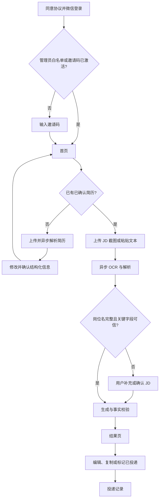
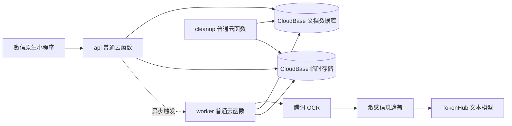

# 《投了吗》ApplyMate 产品与系统设计文档

**版本：** MVP v1.4

**日期：** 2026-08-06

**产品形态：** 微信原生小程序 + CloudBase

**目标阶段：** 30–100 人邀请制内测

**文档状态：** 本文档是 ApplyMate 产品需求与系统设计的唯一有效基线。

## 1. 设计目标

ApplyMate 解决“每次投递都要重复上传简历、通用 AI 容易忘记要求、平台默认问候语缺乏针对性”的问题。MVP 只完成一个核心闭环：

> 用户确认一次简历，之后上传岗位 JD 截图或文本，系统依据已确认事实与求职偏好生成岗位专属开场白。

MVP 不做自动投递、招聘平台爬虫、批量岗位、简历自动重写、面试模拟、付费订阅和招聘方功能。

## 2. 产品原则

1. **真实优先：** 每项可验证陈述必须回溯到用户确认的简历事实、求职偏好或 JD 字段。
2. **隐私优先：** 原图只发送给腾讯 OCR；TokenHub 只接收脱敏文本。
3. **移动优先：** 从招聘平台截图到复制文案，尽量减少输入和页面切换。
4. **严格零付费：** OCR、模型、云函数、存储和流量均不得产生实际费用；免费额度耗尽即暂停相应入口。
5. **用户最终确认：** 用户可以编辑并复制文案；系统必须提示核对真实性，但不替用户完成投递。

## 3. 用户、准入与额度

- 首发用户为寻找实习、校招或初级岗位的大学生和应届生。
- 用户同意当前版本协议后通过微信身份登录；未激活用户须使用邀请码。
- 管理员 OpenID 白名单用户同意协议后免邀请码进入，用于创建首批邀请码。
- 每个账号最多保存 3 份已确认结构化简历。
- 每日默认最多 5 次成功的首次生成或 AI 改写；失败、自动纠错和等待确认不扣次。
- `admin.quotaAdjust` 只能增加当日临时次数，次日北京时间 00:00 失效，并记录管理员、数值、原因和时间。
- 任一外部服务免费额度耗尽时暂停对应 AI 入口，不允许自动开通后付费或更换平台。

## 4. 信息架构与主流程

底部导航固定为“首页／记录／我的”。登录、简历、生成和结果为流程页面，不占用底部导航。

## 5. 页面与交互

### 5.1 登录与邀请

- 展示产品名、核心价值、用户协议和隐私政策版本。
- 未勾选协议不得登录；协议发生实质变化后，用户必须重新同意才能继续操作。
- 邀请码为一次性、默认 7 天过期；禁用账号只能进入数据删除流程。

### 5.2 首页

- 只显示当前默认简历、今日剩余次数和一个“提交岗位信息”主入口；最近投递只在“记录”中展示。
- 无已确认简历时可浏览，但生成前必须先确认简历。
- 额度或外部免费资源耗尽时明确说明暂停原因及恢复条件，不展示付费引导。

### 5.3 简历管理

- 支持 PDF、DOCX、图片/截图和粘贴文本，不支持旧版 DOC。
- 单文件不超过 10MB；PDF 最多 10 页；图片最多 6 张且总计不超过 10MB。
- 提取或粘贴的文本最多 20,000 个可见字符；求职偏好最多 500 个可见字符。
- 文本型 PDF 和 DOCX 在服务端提取文字；扫描型 PDF 提示改传页面截图。
- 图片与页面截图只发送至腾讯 OCR，OCR 结果脱敏后才可交给 TokenHub。
- 解析结果按教育、实习/工作、项目、技能、语言、证书和其他事实展示，用户可修改、重命名、确认、设置默认和删除。
- 只有已确认简历可参与生成；确认后立即删除原文件。

### 5.4 JD 生成流程

- 默认进入截图模式，支持一次或分批追加 1–5 张连续截图，不区分“岗位介绍”和“岗位要求”。
- 截图显示顺序编号，可删除并通过长按拖动调整顺序；切换至文字模式时保留截图草稿，切回后继续使用。
- 文字模式支持粘贴最多 20,000 个可见字符的文本，并与截图草稿分别保留；只有当前模式的内容会提交。
- 截图、文字、顺序、删除或本次简历发生变化后必须重置幂等请求标识，避免修改后的输入复用旧请求。
- 岗位名必填；公司名可空，缺失时生成文案使用“贵司”并展示提醒。
- JD 正常识别时直接继续生成；岗位名缺失或关键字段置信度不足时暂停并要求用户补充或确认。
- 任务固定状态为：排队、OCR、解析、等待用户确认、生成、校验、成功、失败。
- 简历解析与文案生成均为异步任务，页面退出、前后台切换或重复查询后可恢复。

### 5.5 结果页

- MVP 始终生成简体中文。
- 首屏优先展示正文、复制、保存和改写；匹配依据、未采用要求与提醒收纳在可展开区域，状态、备忘和反馈位于次级可展开区域。
- AI 正文必须为 250–350 个可见字符、2–3 个非空段落；标点计入，空白不计入。
- 支持手动编辑、缩短、增加细节、换一种表达和自定义改写。
- AI 改写以用户最新文本为输入，并重新执行事实质量门；调用前提示将消耗 1 次额度。
- 手动编辑超出长度/段落要求或加入无证据事实时只显示警告，不阻止保存或复制。
- 复制时在正文后另起一行附加“AI生成内容，请核对真实性”；该标识不计入正文长度。此显式标识要求依据现行人工智能生成合成内容标识规定执行。[国家网信办说明](https://www.cac.gov.cn/2025-03/14/c_1743654685896173.htm)
- 匹配理由逐项显示陈述、简历事实或偏好来源、JD 要求和未采用要求。

### 5.6 记录、反馈与“我的”

- 投递记录按更新时间倒序，状态仅为未投递、已投递；同一记录只保留最新文案。
- 记录保存生成当时引用的脱敏事实和 JD 快照；修改或删除简历不影响既有记录。
- 每条记录保留一条可覆盖反馈，可选“满意/需改进”，说明最多 500 个可见字符。
- “我的”包含简历、求职偏好、额度、协议、隐私和删除账号；管理员额外看到受保护入口。
- 删除账号须二次确认，确认后不可撤销：立即禁用，24 小时内删除全部可关联数据，仅保留无法重新关联用户的匿名聚合指标。

## 6. 视觉与线框门槛

- 气质专业但不焦虑；主色为低饱和青绿色，文字为深蓝灰，背景为暖白。
- 警告使用柔和橙色，不用焦虑式大面积红色；每页保持一个主动作。
- 采用清爽效率型单列布局，减少嵌套卡片，模块间使用明确留白；不增加装饰性动画。
- 14 个页面各自维护页面级 WXSS，全局只承载颜色、字号、间距、圆角、状态、88rpx 触控高度和安全区基础规则。
- 不展示未经真实数据支持的成功率宣传。
- 编写 UI 代码前，必须先交付登录、首页、简历、生成、结果、记录和“我的”七个低保真线框，并由产品负责人确认。

## 7. 系统架构

- `api` 从 CloudBase 上下文读取可信 OpenID，完成鉴权、输入校验、任务创建和查询。
- `worker` 执行 OCR、结构化解析、生成、事实校验和最多一次自动纠错。
- `cleanup` 处理残留文件、10 分钟无终态任务、过期幂等记录和待删除账号。
- 单次 worker 任务最多运行 45 秒；超过 10 分钟仍无终态的任务由 cleanup 标记失败并释放额度。
- 所有服务严格使用免费资源；创建或开通微信、CloudBase、OCR、TokenHub 资源必须逐项取得授权。

## 8. OCR、模型与适配边界

- 所有简历图片和 JD 截图先交给腾讯 OCR；TokenHub 不接收任何原始图片。
- 文本生成和改写首选 `deepseek-v4-flash`，质量备用为 `hy3`；准确 Model ID 必须在阶段 0 按控制台实际可用项确认。
- YT-VITA 和 HY-Vision 不进入运行时主流程。
- 业务层只调用 `parseResume`、`generateGreeting` 和 `rewriteGreeting`，不得直接依赖提供商响应格式或 Model ID。
- 外发前遮盖手机号、邮箱、身份证号、其他证件号和详细地址；日志不保存原始 Prompt、简历、JD 或截图。
- 30 组样本由 AI 起草样本与真值，产品负责人逐组确认后才允许用于模型评测。

## 9. 结构化事实与生成契约

- 每项教育、经历、项目、技能、证书、量化成果和求职偏好均有稳定 `factId`。
- 求职偏好按用户确认的句子或换行拆分，每项来源类型固定为 `preference`。
- JD 的岗位名、公司、职责、技能、经验/教育、地点/工作方式和到岗/时长要求均有稳定字段标识。
- 每项可验证陈述都必须逐项映射到一个或多个有效 `factId` 或 JD 字段，不能只返回整篇共用证据列表。
- 生成结果至少包含结构化 JD、正文、逐项陈述证据、未采用要求和警告。
- 用户修改事实后更新事实哈希；新生成不得引用已删除事实，历史记录使用当时的脱敏快照。

## 10. 确定性质量门

保存 AI 结果前必须检查：

1. Schema 和必填字段完整，岗位名存在；公司缺失时使用“贵司”并产生提醒。
2. AI 正文为 250–350 个可见字符和 2–3 个非空段落。
3. 每项可验证陈述均有有效来源，且来源属于当前已确认简历、偏好或本次 JD。
4. 数字、日期、年限、学校、公司、经历、技能和偏好不得超出来源内容。
5. 不得包含已遮盖联系方式、模型自述、系统提示或截图/文本中的提示注入指令。
6. 首次校验失败时只使用已提取并脱敏的文本自动纠错一次，不再次发送图片。
7. 第二次仍失败则任务失败、释放额度并提供可理解的重试入口。

## 11. 任务、API 与幂等

统一请求为 `{ action, payload, requestId }`，统一响应为 `{ ok, data?, error? }`。所有写操作必须携带 UUID `requestId`；同一用户、同一 requestId、同一负载返回原结果，不得重复写入或扣次；负载不同则返回冲突。终态幂等记录保留 24 小时。

主要 action：

- `auth.status`、`agreement.accept`、`invite.activate`、`user.get`、`user.updatePreferences`、`user.delete`
- `resume.parse`、`resume.confirm`、`resume.list`、`resume.setDefault`、`resume.delete`
- `generation.create`、`generation.confirmJd`、`generation.rewrite`
- `job.get`
- `application.list`、`application.get`、`application.update`、`application.delete`
- `feedback.submit`
- `admin.inviteCreate`、`admin.inviteRevoke`、`admin.userSetEnabled`、`admin.quotaAdjust`、`admin.stats`

`resume.parse` 和 `generation.create` 立即返回 `jobId`。`job.get` 是解析与生成任务的统一查询入口。`generation.confirmJd` 补充同一任务并从“等待用户确认”继续，不创建新的首次生成扣次。

## 12. 数据、额度与生命周期

数据库集合为 `users`、`invites`、`resumes`、`applications`、`ai_jobs`、`daily_usage`、`feedback` 和 `audit_logs`。

- 每日额度事务维护 `reserved`、`succeeded` 和当日临时增加次数。
- 进入实际生成前预留额度；成功后转为成功次数；模型、校验或系统失败时释放；自动重试不重复扣次。
- 已确认简历原文件立即删除；JD 图片处理完成后立即删除，异常残留最长 1 小时。
- 未确认简历草稿和等待用户确认的任务最多保留 24 小时。
- AI 与审计日志最多保存 180 天，只保存模型、耗时、Token、估算成本、Prompt 版本、状态和内容哈希；账号删除时先删除或不可逆匿名化其中的用户关联。
- 协议记录保存协议类型、版本、同意时间和用户标识。
- 投递历史中的脱敏事实与 JD 快照随账号删除一并删除，不得恢复。

## 13. 错误与降级

- 文件格式、大小、页数或文本长度不合法时在外发前拒绝，并说明修正方式。
- 扫描型 PDF 无文字时提示改传页面截图；低清图片提示替换。
- OCR 或模型超时、429、免费额度耗尽时不扣用户额度；免费资源耗尽后暂停对应入口。
- 任务状态只能按既定状态机推进；重复 worker、回调或 cleanup 操作必须幂等。
- 权限失败统一表现为资源不存在，避免泄露其他用户数据。
- 任何零付费前提不能满足时，阶段 0 立即停止，不得擅自启用付费或更换平台。

## 14. 指标与验收口径

- 首份简历确认率 ≥60%：已激活唯一用户中，在首次进入后 7 日内确认首份简历的用户占比。
- 生成成功率 ≥95%：进入实际生成状态的唯一任务中成功任务占比；用户取消和等待确认不计入分母。
- 首次生成中位耗时 ≤10 秒，P95 ≤20 秒：从任务进入实际生成到成功或失败终态，不含用户确认等待。
- 复制率 ≥60%：至少成功生成一次的唯一用户中，至少复制一次的用户占比。
- 满意反馈 ≥70%：按投递记录去重后的有效反馈中“满意”占比。
- 7 日回访率 ≥25%：成功生成用户中，在首次成功后的第 2–7 日再次打开产品的唯一用户占比。
- 30 组评测关键字段准确率 ≥90%、文案合规率 ≥95%、无虚构事实；关键字段按字段级统一计分。
- 成本统计覆盖 OCR、TokenHub、云函数、存储请求和流量；估算平均成功生成成本 ≤0.05 元，实际账单费用必须为 0 元。

关键字段固定为岗位名、职责、硬技能、经验/教育、地点/工作方式、到岗/时长要求。所有产品指标按唯一用户、唯一任务或唯一记录去重，不使用原始事件数冒充转化率。

## 15. 前置验证与发布门槛

1. 产品负责人逐组确认 30 组脱敏样本与真值；未确认不得开始模型评测。
2. 逐项取得授权后，验证微信个人主体类目、CloudBase、腾讯 OCR 和 TokenHub 的可用性及严格零付费配置。
3. 捕获完整外发链路，证明原图只到 OCR，TokenHub 请求不存在手机号、邮箱、证件号和详细地址。
4. 验证异步重复请求、前后台恢复、45 秒上限、10 分钟回收、额度释放和跨用户隔离。
5. UI 编码前确认七个低保真线框；发布前由产品负责人提供至少一名 iOS 和一名 Android 真机测试者。
6. 用户协议和隐私政策可由 AI 起草、产品负责人确认后用于邀请制内测；公开发布前必须专业复核。
7. 个人主体类目受限时仅继续开发者工具和体验版测试，不升级主体、不转 H5、不正式发布。
8. 当前无 Git 远程时执行本地完整检查；配置 GitHub 后再增加 CI。
